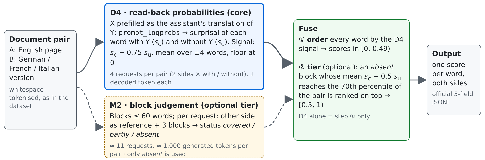

# Reading instead of writing: word-level semantic differences from Apertus read-back probabilities

Method description · Team **Tse-min** — Zhengxun Yin (University of Zurich) · Track 2A – UZH (SwissGov-RSD)

**Code and predictions:** <https://github.com/YinZhengxun/hack-apertus-tsemin> (project root `track_2a/`) · **Report:** `track_2a/Tse-min_Report.pdf` (6 pages) · **Demo** (all pairs, words shaded by score): <https://yinzhengxun.github.io/hack-apertus-tsemin/track_2a/demo/viewer.html> · **Model:** `swiss-ai/Apertus-v1.5-8B` on the CSCS endpoint, inference only; no training; no other model in the pipeline.

**In one paragraph.** We do not ask Apertus to write a label for every word; we let it read. Each document is placed in the prompt as the model's own answer, with and without the other-language page, and the endpoint returns the log-probability of each of its tokens (`prompt_logprobs`). Words whose content is on the other page become easier to predict when that page is shown; words without a counterpart stay surprising. This read-back signal (D4: 4 requests and 4 generated tokens per document pair) reaches a macro Spearman of 0.311 on the test split. Adding whole blocks that Apertus judges to have no counterpart, kept only when the read-back agrees, gives the submitted system (Fuse): **0.323** (de .412 / fr .189 / it .367), against 0.291 for the organisers' CTFAlign alignment system (Wastl et al., 2026b) and −0.015 for the prompting baseline of the SwissGov-RSD paper (Wastl et al., 2026a) run with the same Apertus-8B.

## 1. Method

*Figure 1. Both signals run in both directions of a pair. Solid path: the standalone system D4; dashed: the optional M2 tier.*

**D4 — contrastive read-back (the core).** For side X with counterpart Y we send two chat requests that end with an assistant message containing X verbatim (vLLM `continue_final_message`, `prompt_logprobs=0`, `max_tokens=1`, temperature 0). In the *conditioned* request the user turn gives Y and asks for a faithful and complete X-language version; the *unconditioned* request keeps the system message and only asks for an X-language page of a Swiss government website. The negated sum of a word's token log-probabilities is its surprisal with Y, *s*c(*w*), and without it, *s*u(*w*); both sides of the pair are scored. The word score is

  *v*(*w*) = mean over ±4 words of [ *s*c(*w*) − 0.75 · *s*u(*w*) ],  score(*w*) = 1 − exp(−max(*v*, 0) / 3).

Discounting part of *s*u removes words that are surprising anyway (names, numbers, rare terms); the moving mean reflects that differences come in spans; the floor at zero ties the 62–71 % of words whose signal is not positive, which removes noise from their order. The score ranks suspicion; it is not a probability of difference.

**M2 — block judgements (optional, ≈ 11 requests per pair).** Each side is cut into blocks of at most 60 words at sentence boundaries. A request shows the other side as reference (all of it, or the 1,500 words around the corresponding position) and three blocks, and asks for a JSON status per block: *covered*, *absent* (no counterpart in the reference) or *partly*. Only *absent* is used: on the development split, absent blocks contain 46 / 21 / 45 % gold-difference words (de / fr / it; base rate 13 / 10 / 18 %), while *partly* blocks, 58–63 % of the words, are at the base rate.

**Fuse — the submitted output layer.** An *absent* block is put in a top tier, scores in [0.5, 1), only if the read-back agrees: the block's mean of *s*c − 0.5 · *s*u must reach the 70th percentile of that quantity in the pair. All other words keep their D4 order in [0, 0.49). The metric pools all tokens of a language into one Spearman correlation, so only the order matters and scores are not rescaled per document. The four parameters (percentile 0.7, coefficients 0.5 and 0.75, window ±4) were chosen on 60 development pairs and checked once on dev/val; the configuration was then frozen and the submitted system evaluated on test once.

## 2. Results

*Table 1. Official evaluation script (per language one pooled token-level Spearman, then the mean over the three pairs). Test: 56 pairs per language; dev: 168; dev/val: the 34 held-back pairs of dev. † b0s was run on 60 development pairs only (−.011).*

| System | test de | test fr | test it | **test** | dev | dev/val |
|---|---|---|---|---|---|---|
| **Fuse** (submitted; Apertus-8B) | **.412** | .189 | **.367** | **.323** | **.340** | **.321** |
| D4 alone (Apertus-8B) | .398 | .176 | .359 | .311 | .319 | .318 |
| CTFAlign (organisers' alignment system; not Apertus) | .330 | .189 | .353 | .291 | .306 | .269 |
| Paper prompt with Apertus-8B (b0s) | −.019 | .004 | −.030 | −.015 | — † | — |

**Uncertainty.** Paired bootstrap over pages (1,000 resamples; the same pages drawn for all three languages; 95 % percentile intervals): Fuse − CTFAlign = +0.032 [+0.009, +0.052] on test and +0.033 [+0.020, +0.045] on dev. D4 − CTFAlign = +0.020 [−0.011, +0.045] on test: four read-back requests are on a par with the alignment system. The M2 tier adds +0.012 [−0.001, +0.029] on test and +0.020 [+0.010, +0.032] on dev — a small gain that the test interval does not resolve.

**Ablations** (dev / test, one change at a time). D4 drops from .319 / .311 to .250 / .248 without the *s*u discount and to .258 / .244 without the moving mean; *s*u alone — never showing the other page — gives .014 / .025, so the signal comes from reading the other page. Fuse without the read-back check on M2's blocks: .323 / .312.

**Baseline.** The paper's prompt asks the model to write a score for every word. With Apertus-8B, 47 % of its requests on test ended at the output limit, mostly in repetition loops, and 78–83 % of the words it did label were labelled as different (gold: 9–16 %).

## 3. Efficiency

*Table 2. Cost per document pair on the 60 development pairs where all methods ran (CSCS endpoint; endpoint time = mean live request time × requests per pair).*

| | Requests | Prompt tokens | Generated tokens | Endpoint time |
|---|---|---|---|---|
| D4 (standalone system) | 4.0 | 3,692 | 4 | 3.1 s |
| Fuse = D4 + M2 (submitted) | 15.4 | 24,507 | 1,005 | 10.4 s |
| Paper prompt (b0s) | 3.8 | 6,455 | 8,085 | 49.4 s |

D4 generates about 2,000 times fewer tokens than the paper's prompt and needs a sixteenth of its endpoint time. The M2 tier costs 2.9 times the requests and 2.3 times the endpoint time of D4 for +0.01–0.02. Apertus-70B gave no clear gain on the 60 selection pairs (.363–.376 against .375 for 8B) while its M2 requests took about twice as long, so the 8B model is used throughout. `make run` on the test split (168 pairs) takes 15–25 minutes.

## 4. What is new, and where it breaks

- **Read-back scoring through a hosted chat endpoint.** D4 builds on DiffMask (Vamvas and Sennrich, 2023) and contrastive conditioning (Vamvas and Sennrich, 2022) and is related to context-contrastive likelihoods such as P-CXMI (Fernandes et al., 2023) and PECoRe (Sarti et al., 2024). What we add is its use with a general instruction-tuned decoder behind a chat endpoint: one teacher-forced pass per side and condition, on whole, naturally occurring document pairs, in both directions, without access to the weights.
- **Generation versus probabilities from the same model.** With the paper's prompt, Apertus-8B fails to write word labels; block judgements are useful only for "nothing corresponds"; reading probabilities is both the best and the cheapest signal.
- **Blind spots.** On dev, D4 ranks long missing passages above CTFAlign in German and Italian and level in French (spans of ≥ 5 words: median percentile rank .79 / .67 / .73 against .72 / .66 / .68), but more than half of the single-word differences (a changed number, a more specific term) fall into D4's zero floor, where word alignment still ranks them above chance. French is the weakest pair for Fuse, D4 and CTFAlign and has the lowest human agreement (.436). The blind spots are complementary, so combining D4 with an alignment score is the natural next step.
- **Limits.** D4 needs vLLM extensions (`prompt_logprobs` on a prefilled assistant message, the returned prompt text); `make run` checks the first up front and stops, rather than degrade, if D4 fails. The score orders suspicion; it does not grade the kind or severity of a difference. Four parameters were chosen on 60 pairs, so a selection effect cannot be ruled out completely.

## 5. Reproducibility

`make run` from the repository root (Docker, no GPU) runs a self-test (95 tests), a capability gate that stops with exit code 4 unless the endpoint returns `prompt_logprobs` for a prefilled assistant message (the CSCS endpoint does), M2, D4, Fuse, and an acceptance audit that stops with exit code 3 on any fatal problem. The client retries requests that fail on the shared endpoint (HTTP 5xx), and an inference step that still has failures is attempted up to three times; successful requests are cached on disk. An independent `make run` from another machine gave 0.322. Submitted predictions: `track_2a/data/predictions/full/tsemin_admin_{de,fr,it}.jsonl.jsonl` (224 pairs per language in full-set order; the official script selects the test pairs). The per-document results of every frozen run are in `data/frozen_runs/`, so the tables can be recomputed without the endpoint (`tools/report_tables.py`, `tools/report_extra.py`, `run.py stats`). The test labels entered the project only after the configuration was frozen, and the code refuses to read them without `--allow-test`.

Code: Apache-2.0; this description and the report: CC-BY-4.0; third-party data keep their own licences (`THIRD_PARTY_NOTICES.md`). Code, analyses and texts were written with the help of an AI coding assistant; all design decisions, runs and checks were made and verified by the team.

**References.** Wastl, Vamvas, Sennrich (2026a): SwissGov-RSD: A Human-annotated, Cross-lingual Benchmark for Token-level Recognition of Semantic Differences Between Related Documents, ACL 2026. — (2026b): Scaling Unsupervised Word Alignment to Documents via Structural Constraints, arXiv:2608.21023. — Vamvas, Sennrich (2023): Towards Unsupervised Recognition of Token-level Semantic Differences in Related Documents, EMNLP 2023. — (2022): As Little as Possible, as Much as Necessary: Detecting Over- and Undertranslations with Contrastive Conditioning, ACL 2022. — Fernandes et al. (2023): When Does Translation Require Context?, ACL 2023. — Sarti et al. (2024): Quantifying the Plausibility of Context Reliance in Neural Machine Translation, ICLR 2024.
